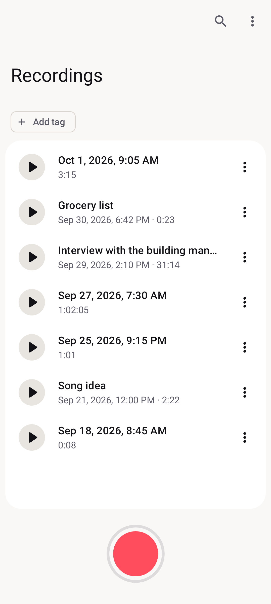
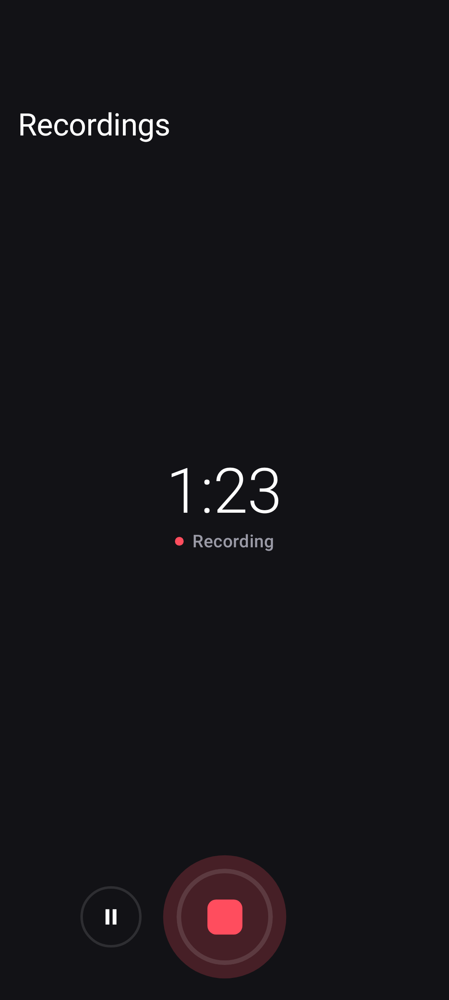
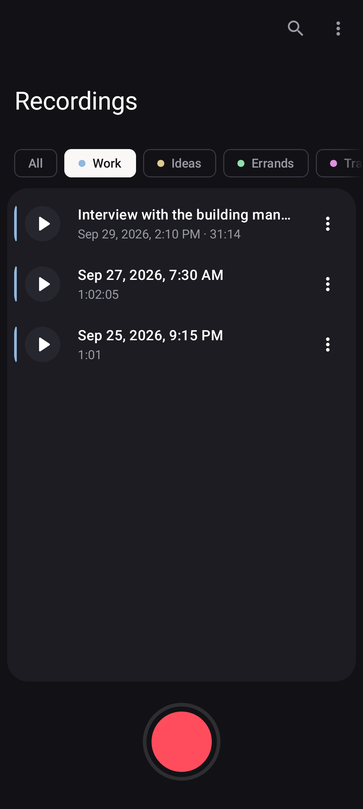

# Voice Memo

A simple, fast voice recorder and player for Android, built with Kotlin and Jetpack Compose.
One big record button, a clean list of recordings, and a recorder that is designed never to lose audio.

<p>
  
  
  
</p>

## Features

- **One tap recording** with pause and resume, running in a foreground service so it keeps going with the screen off
- **Playback** with a seek bar, plus lock screen, notification, and headset controls through a media session
- **Tags** with colors: filter the list by tag, and new recordings pick up the selected tag automatically
- **Search** recordings by title or date
- **Rename, share, and delete** from each recording's menu
- **Import and export**: share audio into the app from other apps, or copy recordings to and from any folder
- Material 3 with dynamic color, light and dark themes, landscape layout, and TalkBack support

## Your recordings are safe

Losing a recording is the worst thing a voice recorder can do, so the app is built around not doing it:

- Audio is streamed to disk as ADTS AAC while recording. If the app or phone dies mid recording, everything captured so far is still playable and is recovered at the next launch.
- On stop, the stream is losslessly remuxed into a standard `.m4a`. The original is only removed after the `.m4a` is flushed to disk and verified to contain every byte. If anything doesn't add up, the raw file is kept and marked "Unprocessed".
- Files are the source of truth. The database only holds titles and tags, and is resynced with the files on disk at every launch.
- Playback is blocked while recording, including from headset buttons and system media controls.

Recordings live in the app's private storage. Nothing leaves your phone unless you share or export it: no accounts, no ads, no analytics.

## Install

Download the APK from the [latest release](https://github.com/p4tr0/memo-recorder/releases/latest) and open it on your phone (you'll need to allow installs from that source). Requires Android 8.0 (API 26) or newer.

The app is not on Google Play.

## Build from source

Requirements: JDK 17 or newer to launch Gradle (the build provisions JDK 21 for the daemon and tests) and the Android SDK.

```sh
./gradlew assembleDebug          # build a debug APK
./gradlew installDebug           # install it on a connected device
./gradlew testDebugUnitTest      # unit and screenshot tests (Robolectric + Roborazzi)
./gradlew connectedDebugAndroidTest  # media tests on a device or emulator
```

Release builds are signed with a key kept outside the repository. Without it, `assembleRelease` fails on purpose; use debug builds for local work.

## Tech stack

- Kotlin, Jetpack Compose, Material 3
- `MediaRecorder` (ADTS AAC) and `MediaMuxer` for recording and remuxing
- Media3 ExoPlayer and `MediaSessionService` for playback
- Room for metadata, MVVM with `StateFlow`, manual dependency injection
- Robolectric and Roborazzi screenshot tests, instrumented tests for the media pipeline

## Project layout

```
app/src/main/kotlin/io/github/p4tr0/voicememo/
  ui/          Compose screens, view models, theme
  recording/   foreground service, recorder, ADTS to m4a remuxer, storage
  playback/    media session service and recording guard
  data/        Room database, repository, import and export
app/src/test/        unit and screenshot tests (goldens in app/src/test/screenshots/)
app/src/androidTest/ instrumented tests on the real media framework
```
